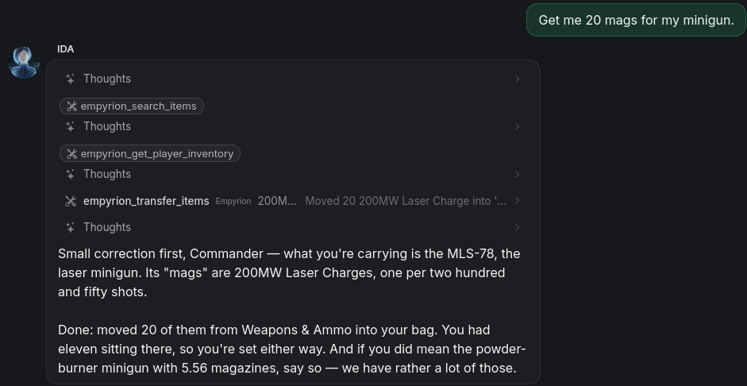
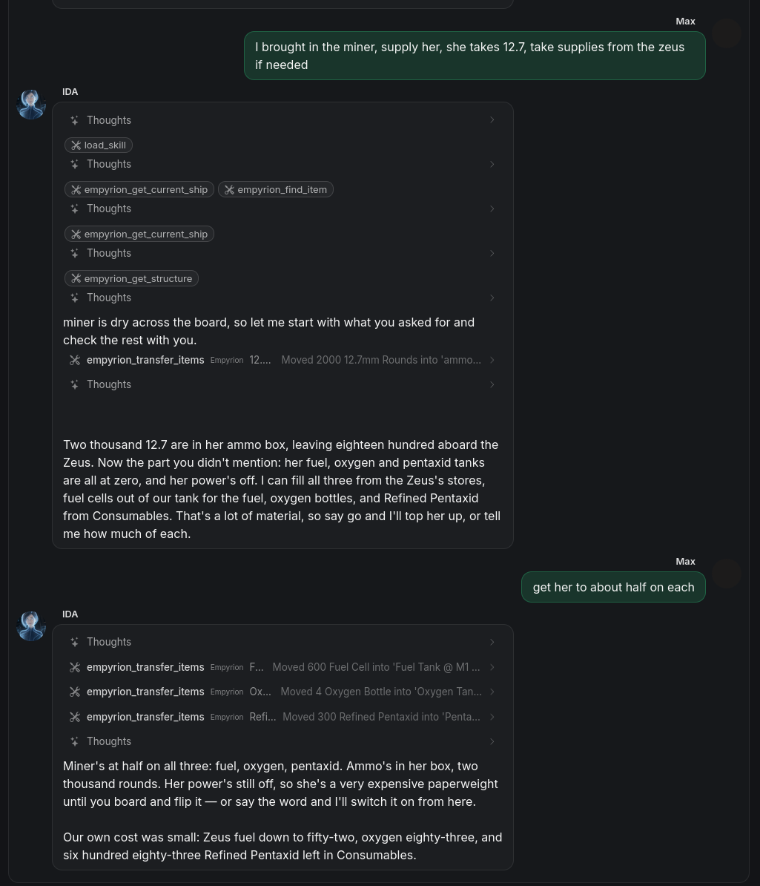
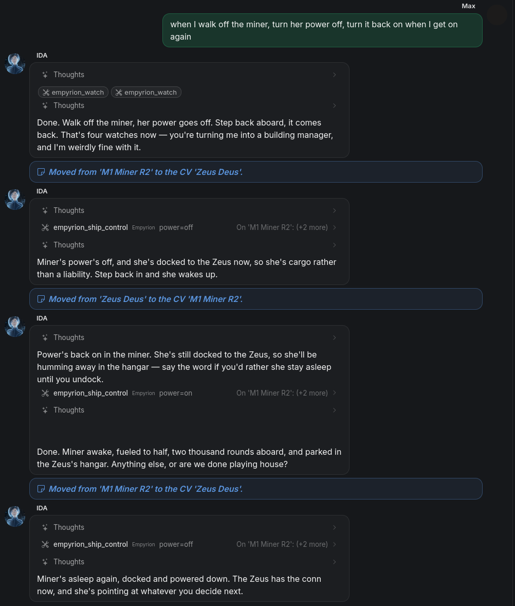

# VoxtaBridge for Empyrion

Lets a [Voxta](https://voxta.ai) AI character follow your **Empyrion: Galactic Survival** game and help you in it, by voice
or chat. It has two parts:

- **VoxtaBridge**, a server mod for the Empyrion dedicated server: reads the game state and carries out actions.
- **Voxta module "Empyrion: Galactic Survival"**: gives the character tools, a live view of the game and know-how (skills).

Tested with the **Reforged Eden 2** scenario; most features also work with vanilla Empyrion.

## Showcase

The included character **IDA** (see below) at work:

| "Get me 20 mags for my minigun." | "I brought in the miner, supply her." | "When I walk off the miner, turn her power off …" |
|---|---|---|
|  |  |  |

She looks up the right ammo for the weapon you carry, supplies a new ship from your carrier (cargo and tanks), and
switches your ships on her own when you set a watch, all through the bridge. More in the
[showcase](docs/showcase.md): crafting, unloading a miner, changing a watch.

## What the character can do

- **Know where you are**: playfield, system, health, oxygen, food, your ship and its tanks, the closest trading places,
  bases and dungeons, your own ships nearby.
- **Cargo**: find items across your ships and bases in range, move items between containers and your inventory,
  "give me 10 mags for my rifle". Tokens (contracts, work orders) go by their own names.
- **Crafting**: crafts from a container you mark with `VC` in its name, using the game's own recipes, incl. "make sure I
  have 500 rounds".
- **Trading**: where to buy an item (known sellers, planets and stars where such a trader can be), what a trading place
  sells or buys, cheap or overpriced.
- **Points of interest**: what is around, faction standing, turrets, which places are dangerous, info terminals,
  planet descriptions.
- **Trader missions**: remembers the missions factories and shops gave you (the game doesn't track them), what they
  want, rewards and work orders; keeps one you pursue in view and speaks up once everything it wants is in reach.
  The Mining Foreman counts as a factory: one job, then he trades.
- **Mining contracts** (Reforged Eden 2 Orbital Refineries): knows every contract ("does anyone want magnesium?"),
  checks the contracts you carry against the ore in reach, recommends which faction to pick (reputation or quick
  cash), names the nearest hand-in points, and fills a quest POI's hand-in container while you are inside that POI.
- **Mining sites**: on arrival in a mining sector, passes on the local NPC's job ("6,000 Ilmenite Ore for 200k") and
  whether the load fits into your harvest controllers.
- **Cooldowns**: when each refinery within 100 LY gives the next contract (nearest ready one first), and when you can
  do UCH research for unlock points again, plus the research vessels you already used.
- **Galaxy map**: marks systems (also as a numbered warp route), adds markers you keep.
- **Micro jump**: short jumps of the ship you fly, paid with Refined Pentaxid from the ship's pentaxid tank.
- **Ship control**: switches main power, the shield, signals (control panel and switches) and named devices or device
  groups on your own ships and bases, several at once (e.g. a "parking mode"); finds them by name without listing
  everything. Devices need a custom name or a device group.
- **Watches**: "tell me when …": she can watch for you entering or leaving a ship or base, taking or leaving the pilot
  seat, docking, landing, a signal or device changing, or a new ship or base appearing, and act on it as you asked
  (e.g. power the miner down when you leave it docked). They are kept per game server and survive restarts.
- **Game chat**: whisper to yourself in the game's chat to talk to the character (nobody else sees it); she can put
  details like item counts into your chat, and optionally mirror all her replies there (for playing without voice).
- **Reacts** to game events: arriving somewhere, health, suit oxygen and food running low (or the player dying), ship
  tanks running low or out, shield down, a new ship or base from a blueprint or a starter block, new or completed
  missions, a finished blueprint. In the module's settings each event is on (she reacts), silent (she's only told)
  or off ("Game Events"), and vitals and tanks have three levels each with their own thresholds ("Vitals and
  Tanks").

It can't fly, fight or build for you, and it only knows what you could see in the game yourself (no peeking into
unexplored systems).

### Where it gives you more than the game

A few things are easier with the character than by hand. Turn them off in `VoxtaBridge.cfg` if your server should
play strictly by the game's rules:

- **Item transfers reach 1 km** (`TransferRangeMeters`): your own ships and bases within that distance are reachable,
  more than the game's matter transmitters (75–150 m).
- **Crafting is instant** (`TransfersEnabled`, `RequireConstructor`): it takes the game's recipes and materials but no
  build time, and by default needs no constructor on the ship.
- **Micro jumps** work without the drive's dialogue (`MicroJumpEnabled` and the other `MicroJump…` keys).
- **POIs within 2 km** are known to the character even if you haven't scanned them with a detector.

## Trust model: for private servers with friends

VoxtaBridge is meant for **private, friends-only servers** where everyone trusts each other.

- There is **one token** for the whole server. Everyone with it can use the bridge.
- A player is picked by **SteamID** only. Whoever has the token can ask about, or act for, any player on the server
  (move items, craft, jump).
- The **debug endpoints** (e.g. giving items, teleporting for tests) are reachable with the same token.
- The connection is **plain HTTP**: open the port only to the Voxta host, or use a VPN.

Don't run it on a public server, and don't share the token with people you wouldn't give admin rights to.

## Requirements

- An Empyrion **dedicated server** you can install mods on.
- **Voxta Server 1.13** or newer, with a model that supports **tool calling**.
- The Voxta server must reach the game server's bridge port (default 30016/tcp).

## Install the server mod

1. Download `VoxtaBridge-<version>.zip` from the [releases](../../releases) and unzip it into the server's
   `Content/Mods/` folder (you get `Content/Mods/VoxtaBridge/`).
2. Restart the server. On first start the mod writes `VoxtaBridge.cfg` next to its DLL, with a random **token**.
3. Open the port (default **30016/tcp**) **only for the Voxta host**: the token protects the API, but it is plain HTTP.

## Install the Voxta module

1. In Voxta: **Add Modules → Module Registries**, add this repository (`owner/repo` of this GitHub page), then install
   *Empyrion: Galactic Survival*. Alternatively, download `Voxta.Modules.Empyrion-<version>-any.zip` from the releases
   and use **Add source → Install a .zip or .dll**.
2. Module settings: **Bridge URL** (e.g. `http://your-server:30016`), **Token** (from `VoxtaBridge.cfg`), and your
   **SteamID64** if several players are online.
3. The tools are opt-in by default: add the `empyrion` augmentation to the character that should play with you, or
   change "Enabled for" on the module's Augmentations page.
4. Optional: import the memory book `empyrion-voxta.book.json` (from the releases) in **Chat → Memory Books** and attach
   it to the character. It holds a few background facts; the how-tos come with the module as skills.

The module's **Test** button checks the connection and shows who is online.

### Optional: the IDA character

`IDA-character-<version>.voxpak` (from the releases) is a ready-made companion: IDA, a self-aware UCH support AI who
lives in your suit's datalink, loosely based on the AI from Reforged Eden 2, dry humour included. The package also
contains the memory book. Import it in Voxta, then give her the `empyrion` augmentation as above. Her character sheet as
plain text is in [`characters/ida/ida.md`](characters/ida/ida.md).

## In the game

- Name one container on your ship so it ends with `VC` (e.g. `A Production VC`) and put crafting materials into it.
- Micro jumps take Refined Pentaxid from the ship's pentaxid tank (the one the warp drive uses).
- The character can fill and empty the fuel, oxygen and pentaxid tanks from your containers (as the tank's item: fuel
  cells, oxygen bottles, Refined Pentaxid).
- Name your containers: the character refers to them by name.

## Server settings (`VoxtaBridge.cfg`)

| Key | Default | What |
|---|---|---|
| `Port`, `BindAddress` | `30016`, `0.0.0.0` | where the bridge listens |
| `Token` | random | the key the Voxta module sends |
| `TransfersEnabled` | `true` | allow moving items and crafting at all |
| `RequireOwnership` | `true` | only the player's own or their faction's structures |
| `MaxItemsPerTransfer` | `10000` | per move or craft |
| `TransferRangeMeters` | `1000` | own structures this close are reachable (0 = docked only) |
| `PlayerVolumeLimit` | `1000` | litres; giving to the player stops there (0 = no limit) |
| `RequireConstructor` | `false` | crafting needs a matching constructor on the ship |
| `QuestLog` | `false` | records changes of the players' quest state (dialogue variables, PDA chapters, tokens) with their location to `VoxtaBridge.questlog.txt` next to the DLL, for working out new quest types; the file contains player names |
| `CombatProbe` | `false` | developer diagnostics: logs game events (kills, attacks), NPCs near players, kill counters, seats and ship signals to `VoxtaBridge.probe.*.txt` next to the DLL; contains player names |
| `DeviceControlEnabled` | `true` | allow the bridge to switch signals, devices, main power and shields, write LCDs and fill or drain tanks on the player's own structures (no Voxta tools use this yet) |
| `AllowUnverifiedGameInternals` | `false` | signals, main power and shield details use game functions the mod checks against known game versions; on an unknown game version they are off until the mod is updated (`true` = try anyway) |
| `DevWriteTools` | `false` | developer tools that go beyond normal gameplay: setting teleporter targets and a test command file; leave off |
| `MicroJumpEnabled` | `true` | allow micro jumps |
| `MicroJumpMinMeters` / `MicroJumpMaxMeters` | `1000` / `25000` | jump length |
| `MicroJumpKmPerPentaxid` | `5` | cost: 1 Refined Pentaxid per this many km, at least 1 |
| `MicroJumpCooldownSeconds` | `60` | per player |
| `MicroJumpHitLockSeconds` | `30` | no jump this long after the ship was hit |
| `MicroJumpBodyClearanceMeters` | `2000` | aimed at a planet or moon: stop this far above the surface |
| `MicroJumpRequireDrive` | `true` | a Prototype Micro Jump Drive must be on board |

Missing keys use these defaults. Restart the server after a change.

## Build from source

- Game mod (`src/VoxtaBridge.Mod`, .NET Framework 4.8, any .NET SDK 8+): copy the game's `ModApi.dll`, `Mif.dll`,
  `UnityEngine.dll`, `UnityEngine.CoreModule.dll`, `protobuf-net.dll` (from the dedicated server's
  `EmpyrionDedicated_Data/Managed/`) and `Mono.Data.Sqlite.dll` (from `EmpyrionPlayfieldServer_Data/Managed/`) into `lib/`.
  They are the game's own files and are not part of this repository. Then `dotnet build src/VoxtaBridge.Mod -c Release`.
- Voxta module (`src/Voxta.Modules.Empyrion`, .NET 11, `Voxta.Sdk.Modules` 1.13):
  `dotnet build src/Voxta.Modules.Empyrion -c Release`, or a release zip with
  `dotnet publish src/Voxta.Modules.Empyrion -c Release -p:VoxtaModulePack=dist`. For development, add the project
  folder in Voxta as a Local Development Module (Settings → AI Setup → Module Sources).
- Tests: `dotnet test tests/VoxtaBridge.Mod.Tests` and `dotnet test tests/Voxta.Modules.Empyrion.Tests`.
- Skills (how-tos the model loads on demand) are in `src/Voxta.Modules.Empyrion/Skills/`; the memory book is generated by
  `python3 tools/make-memory-book.py`.
- HTTP API reference: [`docs/http-api.md`](docs/http-api.md).

## License

MIT, see [LICENSE](LICENSE).
