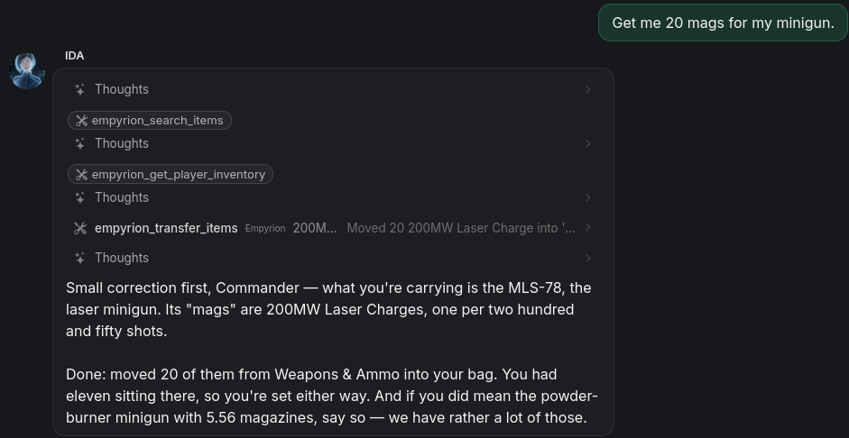
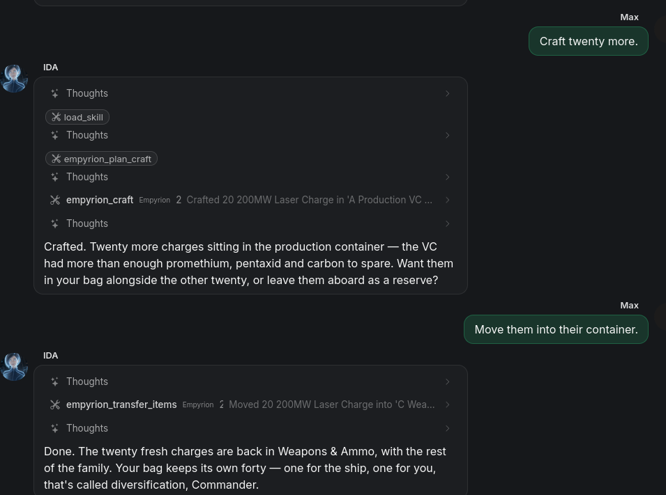
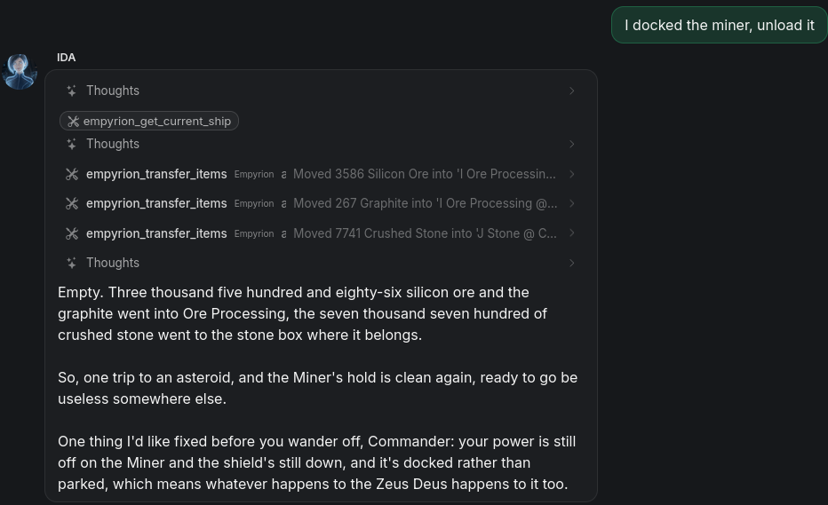
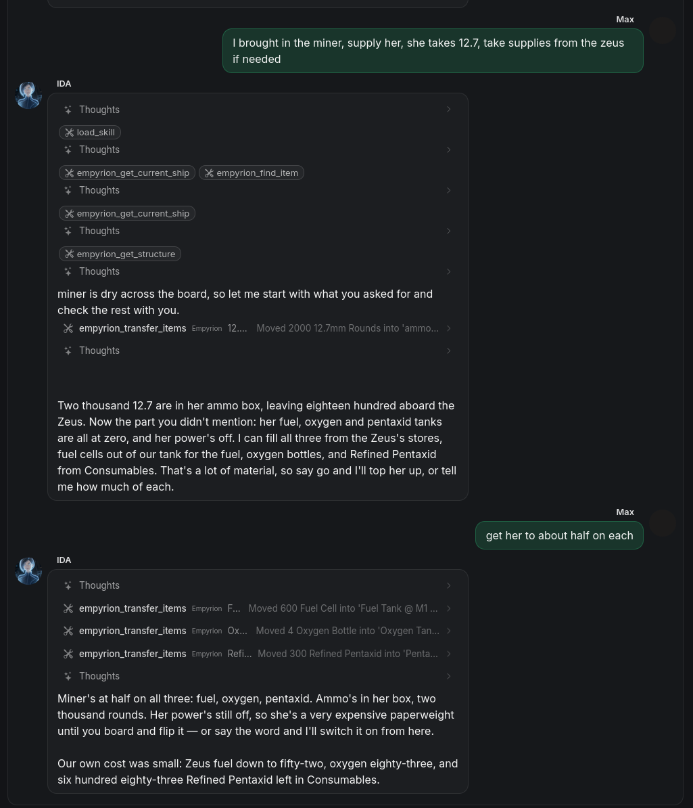
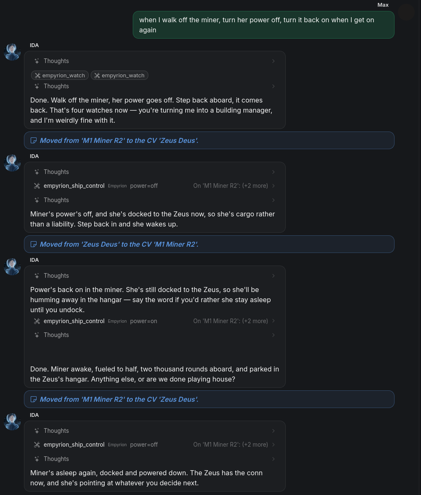
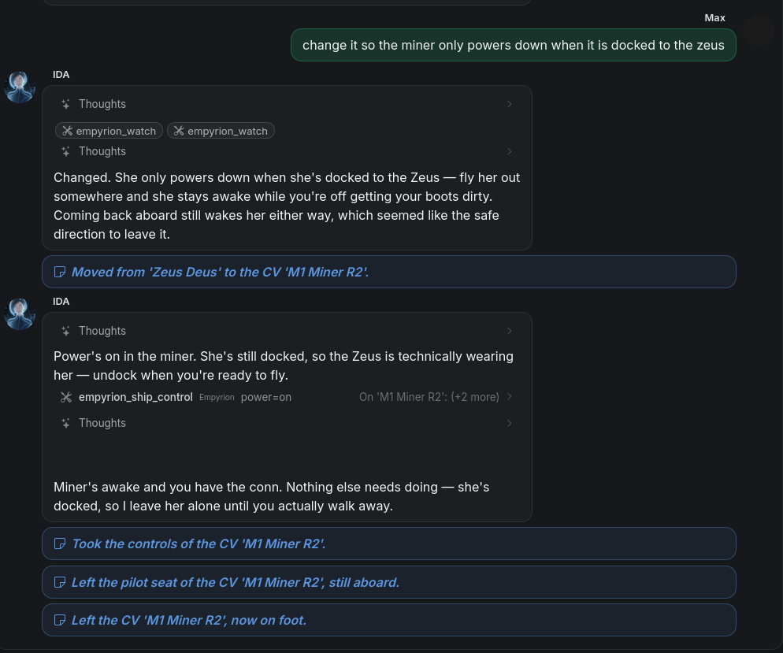

# Showcase

The included character **IDA** at work, as screenshots from Voxta chats while playing. Tool calls show as small cards
between her lines; quiet game notes the module passes on show as blue boxes.

## Cargo and crafting

| "Get me 20 mags for my minigun." | "Craft twenty more." | "I docked the miner, unload it." |
|---|---|---|
|  |  |  |

She looks up the right ammo for the weapon you carry, crafts from your ship's production container, and sorts cargo
into the containers where it belongs.

## A new ship

"I brought in the miner, supply her": she finds what the miner takes, moves ammo over from the carrier, notices the
empty tanks on her own and fills fuel, oxygen and pentaxid to the level asked for, from the carrier's tank and cargo.

## Watches and ship control

| "When I walk off the miner, turn her power off …" | "… only when it is docked to the carrier." |
|---|---|
|  |  |

She sets two watches ("tell me when …") and switches the miner's main power each time you walk off or come back
aboard; asked to, she narrows the watch to "only while docked".
